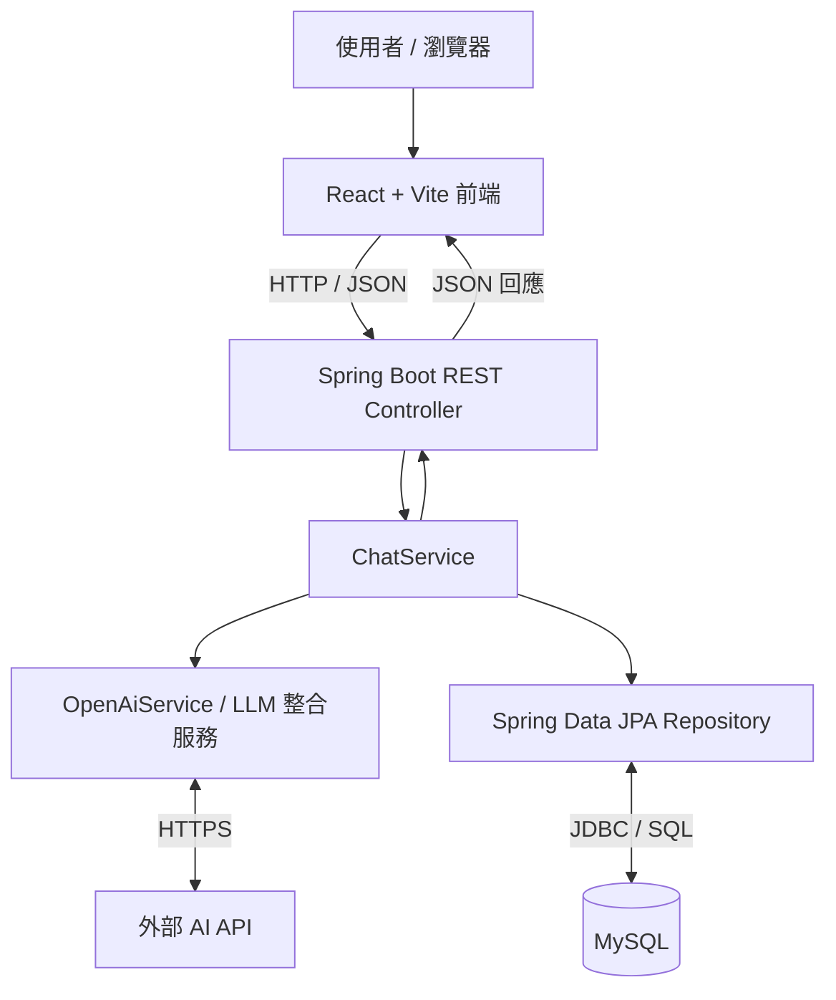

# Chatbot Website｜AI 聊天網站

使用 **React、Spring Boot、MySQL 與大型語言模型（LLM）API** 開發的全端 AI 聊天網站。使用者可以在網頁輸入問題、取得 AI 回答，並查看聊天紀錄。

## 主要功能

- **AI 即時問答**：將使用者輸入送至後端，由串接的 LLM API 產生回答。
- **聊天紀錄顯示**：以時間順序顯示使用者與 AI 的對話。
- **清除紀錄**：介面提供「清除紀錄」按鈕；是否同步刪除資料庫紀錄取決於後端實作。
- **對話介面**：區分使用者與 AI 訊息樣式，提供訊息輸入框及 Send 按鈕。
- **資料持久化**：使用 Spring Data JPA / Hibernate 與 MySQL 儲存聊天資料（實際欄位依 Entity 定義）。

## 技術架構（Tech Stack）

| 層級 | 使用技術 | 用途 |
| --- | --- | --- |
| 前端 | React、JavaScript、Vite | UI、訊息輸入與顯示 |
| 後端 | Java 17、Spring Boot、Spring Web MVC | REST API 與業務邏輯 |
| AI 串接 | Spring AI、OpenAI API | 呼叫外部 AI 模型 |
| 資料庫 | MySQL、Spring Data JPA、Hibernate | 儲存對話資料 |
| 建置工具 | Gradle、npm | 後端與前端依賴管理 |

## 系統架構



**對話處理流程：**

1. 使用者在 React 網頁輸入訊息並按下 Send。
2. React 透過 HTTP 將請求傳送到 Spring Boot REST API。
3. Controller 呼叫 Service，並透過 LLM 整合服務向外部 AI API 請求回答。
4. 後端透過 JPA Repository 將聊天資料寫入 MySQL（依實際程式碼執行）。
5. 後端回傳 JSON，React 更新畫面並顯示 AI 回答。

> API 路徑、儲存時機，以及清除紀錄是否刪除 MySQL 資料，請以 Repository 實際程式碼為準。

## 專案目錄結構

```text
chatbot-website/
├── backend/
│   ├── build.gradle
│   ├── settings.gradle
│   ├── gradlew                       # 若有提交 Gradle Wrapper
│   └── src/main/
│       ├── java/com/example/gptchat/
│       │   ├── GptChatApplication.java
│       │   ├── config/WebConfig.java
│       │   ├── controller/ChatController.java
│       │   ├── dto/ChatRequest.java
│       │   ├── dto/ChatResponse.java
│       │   ├── entity/ChatMessage.java
│       │   ├── repository/ChatMessageRepository.java
│       │   └── service/
│       │       ├── ChatService.java
│       │       └── OpenAiService.java
│       └── resources/application.properties
└── frontend/
    ├── src/App.jsx
    └── package.json
```

## Demo圖示


